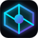

# NEXUS OS — Ultimate Live Touch Dashboard

> **A high-density, futuristic smart operating system dashboard engineered for 10.1" touchscreen kiosks (Rockchip RK3326 / Android 8.1 / Fully Kiosk Browser) and static deployment on GitHub Pages.**



---

## 1. System Overview

**NEXUS OS** combines the visual refinement of Apple, the high information density of Bloomberg Terminal, the sleek minimalism of Tesla, and the ergonomics of a luxury smart-home control panel.

Built specifically to run reliably 24/7 on low-powered digital photo frames (such as the Rockchip RK3326 quad-core ARM Cortex-A35 running Android 8.1 and Fully Kiosk Browser 1.61), NEXUS OS features zero runtime dependencies, hardware-accelerated canvas/SVG rendering, and a centralized async data engine that eliminates duplicate requests, respects API rate limits, and persists gracefully through offline conditions.

---

## 2. Target Device & Display Specifications

| Specification | Target Hardware | NEXUS OS Optimization |
|---|---|---|
| **SoC / CPU** | Rockchip RK3326 (Quad Cortex-A35) | Zero-dependency pure JavaScript; no heavy React/Vue runtime overhead |
| **GPU** | Mali-G31 MP2 | Hardware-accelerated CSS transforms; no heavy `backdrop-filter` blurs |
| **Operating System** | Android 8.1 Oreo | Clean ES6 compatibility targeting Chromium/WebView 60+; polyfill-free |
| **Display & Resolution** | 10.1-inch IPS, 1280 × 800 (16:10) | Pixel-perfect grid layout optimized specifically for 1280×800 landscape |
| **Kiosk Runtime** | Fully Kiosk Browser 1.61 | Native integration with `window.fully` JavaScript interface for fullscreen |
| **Input Method** | Touchscreen only (no mouse/keyboard) | Minimum 44px–52px touch targets; active tactile touch feedback |
| **Deployment Host** | GitHub Pages (Public Static HTTPS) | 100% relative asset paths (`./css`, `./js`); zero server required |

---

## 3. Architecture & Views Directory

NEXUS OS is organized as a single-page application with a persistent navigation dock and 7 primary views:

### 1. Header & Live Ticker Strip
- **Top System Bar**: Brand emblem, active network heartbeat (`ONLINE` / `OFFLINE`), high-precision digital clock (hours, minutes, seconds, 12/24h toggle), full day and date, Glasgow quick-weather pill, manual refresh trigger, demo mode switch, and kiosk fullscreen toggle.
- **Live Ticker Tape**: Scrolling real-time financial quotes across FTSE 100, S&P 500, NASDAQ, BTC/GBP, ETH/GBP, GBP/USD, EUR/USD, NVDA, TSLA, and AAPL.

### 2. View 1: Overview Dashboard
- **Glasgow Weather Centre**: Live temperature, feels-like, WMO conditions, high/low range, precipitation probability, wind speed/direction, relative humidity, UV index, and 24-hour hourly preview strip.
- **Crypto Command Centre**: Real-time prices for BTC, ETH, SOL, XRP, DOGE, ADA in GBP, USD, or EUR; 24h percentage delta pills; and dynamic SVG sparkline charts.
- **Global Stock Indices & Equities**: FTSE 100, S&P 500, NASDAQ, Dow Jones, and popular tech equities with market status.
- **Currency & Central Bank Rates**: Official European Central Bank (ECB) reference rates via Frankfurter API with interactive currency conversion calculator.
- **Seismic & Orbital Radar**: Real-time International Space Station (ISS) velocity, altitude, and coordinates alongside USGS 24-hour earthquake monitor.
- **Live News Wire**: Real-time public news streams covering Tech (Hacker News), Space (SpaceFlight News), and UK headlines.
- **Focus & Productivity Hub**: Embedded mini Pomodoro timer and auto-saving scratchpad.

### 3. View 2: Financial Markets Terminal
- Comprehensive global indices breakdown (FTSE 100, S&P 500, NASDAQ, Dow Jones, DAX 40, Nikkei 225).
- Custom equities watchlist with real-time **Add Ticker** and **Remove** controls (persisted in `localStorage`).
- Interactive financial performance canvas chart with crosshair analysis and timeframe toggles (1D, 1W, 1M, 1Y).
- Full cryptocurrency market depth table with market capitalization and volume metrics.

### 4. View 3: Meteorological Observatory
- Detailed meteorological metrics: Apparent temperature, precipitation volume (mm), wind gusts, barometric pressure (hPa), European Air Quality Index (AQI), PM 2.5 fine dust concentration, sunrise, sunset, and remaining daylight hours.
- High-resolution 24-Hour hourly canvas chart plotting temperature curves and precipitation probability bar columns.
- 7-Day extended meteorological outlook with high/low temperature bars and condition iconography.
- **Interactive City Search**: Geocoding API integration allowing search for any city worldwide, with a one-tap Glasgow reset button.

### 5. View 4: World Time, Seismology & Space
- Synchronized world clocks across Glasgow/London, New York, Tokyo, Dubai, Sydney, and San Francisco.
- Interactive USGS earthquake activity monitor with magnitude filters (All, M2.5+, M4.5+) and seismic depth metrics.
- High-frequency ISS orbital radar tracking velocity (27,600 km/h), latitude, longitude, altitude, and daylight visibility.
- Astronomical lunar ephemeris calculator computing exact moon phase name, illumination percentage, days to full moon, and days to new moon with realistic visual shadow rendering.
- Real-time spaceflight and astrophysics news wire.

### 6. View 5: Interactive Utilities Suite
1. **Touchscreen Calculator**: Clean arithmetic keypad with operational history.
2. **Pomodoro Focus Engine**: 25m focus / 5m break cycles with status display.
3. **Precision Stopwatch**: 10ms accuracy with lap timing recorder.
4. **Countdown Timer**: Quick presets (1m, 5m, 15m, 30m) and custom countdowns.
5. **Mortgage Repayment Calculator**: Loan amount, interest rate, term -> monthly payment and total interest.
6. **Compound Interest Calculator**: Initial deposit, monthly contribution, rate, horizon -> projected future wealth.
7. **Percentage & UK VAT Calculator**: Standard 20% VAT, markups, and discounts.
8. **Notes Scratchpad**: Comprehensive memo editor auto-saved to local browser storage.
9. **Touch To-Do List**: Task management with completed strike-through and deletion.
10. **Offline QR Code Generator**: Pure client-side SVG QR code generator that runs 100% offline without sending user data to third-party servers.

### 7. View 6: Smart Home Integration Center
- Architecture blueprint for private home automation.
- Security camera stream containers with active timestamps, framerate badges, and HLS/WebRTC gateway setup guidance.
- Interactive climate thermostat dial with target temperature adjustments.
- Smart lighting and power plug toggle switches with local state memory.

### 8. View 7: Customisation Engine
- **Visual Palettes**: 6 futuristic themes (Cyber Obsidian, Midnight Blue, Matrix Emerald, Solar Amber, Crimson Protocol, Titanium Light).
- **Accent Lighting**: 6 neon accent colors (Electric Cyan, Hyper Blue, Emerald, Ultraviolet, Amber, Crimson).
- **Display Density**: Kiosk Touch (1280×800 Optimized), Ultra Compact, Comfortable.
- **Widget Manager**: Enable/disable individual cards and reorder via touch arrows or drag.
- **Units & Regional**: 12h/24h time, seconds toggle, Celsius/Fahrenheit, mph/kmh/ms, GBP/USD/EUR.
- **Backup & Diagnostics**: One-click JSON configuration export, JSON import, factory reset, and hardware diagnostic readout.

---

## 4. Live Data Sources Directory

All core data sources in NEXUS OS are **100% genuine, free, require no private API keys, and work directly from static client-side hosting via HTTPS and CORS**:

| Provider / API | Function | Auth Required | Free Tier Limit | Client CORS Status |
|---|---|---|---|---|
| **Open-Meteo Weather** | Hourly & 7-day weather forecast, rain probability, wind, UV | None (Public) | 10,000 calls / day | Native HTTPS CORS |
| **Open-Meteo Air Quality** | European AQI, PM2.5, NO2 | None (Public) | 10,000 calls / day | Native HTTPS CORS |
| **Open-Meteo Geocoding** | Global city location search | None (Public) | 10,000 calls / day | Native HTTPS CORS |
| **CoinGecko API** | Live crypto prices, 24h change, market cap | None (Public) | 30 calls / min | Native HTTPS CORS |
| **Kraken Public Ticker** | Dual-provider crypto fallback | None (Public) | 1 call / sec | Native HTTPS CORS |
| **Frankfurter API** | European Central Bank daily foreign exchange rates | None (Public) | Unlimited (Open Source) | Native HTTPS CORS |
| **USGS Earthquake Feed** | Real-time global seismic events & magnitudes | None (Public) | Unlimited | Native HTTPS CORS |
| **WhereTheISS API** | Real-time ISS coordinates, speed & altitude | None (Public) | 1 call / sec | Native HTTPS CORS |
| **Hacker News Firebase API** | Live technology headlines | None (Public) | Unlimited | Native HTTPS CORS |
| **SpaceFlight News API** | Real-world spaceflight & astrophysics articles | None (Public) | Generous public tier | Native HTTPS CORS |

> **Delayed Data Policy**: Stock market indices and equities are clearly labelled with the `DELAYED` badge. NEXUS OS never manufactures fake stock quotes.

---

## 5. Fully Kiosk Browser Setup (Android 8.1 / RK3326)

To configure your 10.1" digital photo frame for always-on kiosk operation:

1. **Install Fully Kiosk Browser**: Download and install Fully Kiosk Browser (v1.61 or newer) on your Android 8.1 device.
2. **Configure Start URL**:
   - Go to `Settings > Web Content > Start URL`.
   - Enter your GitHub Pages URL: `https://<USERNAME>.github.io/<REPO-NAME>/` (or local file path if loading locally).
3. **Enable Always-On Display**:
   - `Settings > Device Management > Keep Screen On`: Set to **True**.
   - `Settings > Device Management > Screen Off Timer`: Set to **Never**.
   - `Settings > Power Settings > Prevent Sleep While Charging`: Set to **True**.
4. **Enable Kiosk Mode**:
   - `Settings > Kiosk Mode > Enable Kiosk Mode`: Set to **True** (locks device to NEXUS OS).
   - `Settings > Advanced Web Settings > Enable JavaScript Interface`: Set to **True** (enables native fullscreen control via `window.fully`).
5. **Disable Unwanted Gestures**:
   - `Settings > Web Browsing > Enable Pull to Refresh`: Set to **False** (NEXUS OS has an internal async refresh engine).
   - `Settings > Web Browsing > Enable Zoom`: Set to **False** (prevents accidental pinching).

---

## 6. Private-Hosting Upgrade Path (Cloudflare Pages + Access)

While NEXUS OS deploys natively to public GitHub Pages, you can migrate to private hosting without altering any frontend code:

### Step 1: Connect to Cloudflare Pages
1. Log in to the [Cloudflare Dashboard](https://dash.cloudflare.com/) and navigate to **Workers & Pages > Create application > Pages > Connect to Git**.
2. Select your GitHub repository.
3. Configure build settings:
   - **Framework preset**: None
   - **Build command**: *(leave empty)*
   - **Build output directory**: `.` (root directory)
4. Click **Save and Deploy**. Your dashboard will deploy under `https://<PROJECT-NAME>.pages.dev`.

### Step 2: Restrict Access with Cloudflare Access (Zero Trust)
1. In Cloudflare Zero Trust, navigate to **Access > Applications > Add an application > Self-hosted**.
2. Set the Application Domain to your Cloudflare Pages domain (or custom domain).
3. Configure Policies:
   - **Action**: Allow
   - **Include**: Emails / Domain (e.g. your personal email address).
   - **Session Duration**: For an always-on kiosk frame, set the session duration to **1 Month** or use a **Service Auth Token / Mutual TLS** so the frame never gets logged out.

### Step 3: Optional Secure Camera & Home Automation Gateway
To securely stream local RTSP cameras to NEXUS OS on Cloudflare Pages:
1. Run **go2rtc** or **Home Assistant** behind a **Cloudflare Tunnel** (`cloudflared`).
2. Cloudflare Tunnel exposes the WebRTC / HLS video stream over secure HTTPS without opening ports on your home router.
3. Point the NEXUS OS Smart Home video component to your authenticated HTTPS stream URL.

---

## 7. How to Add Additional Widgets

The codebase is built with a modular component architecture:

1. **Add HTML markup**: Add your widget card inside `<div class="widgets-grid">` in `index.html`.
2. **Register in Storage**: Add the widget descriptor to `DEFAULT_CONFIG.widgets` in `js/storage.js`.
3. **Create Widget Module**: Create `js/widgets/<name>.js` with a class adhering to the lifecycle:
   ```javascript
   class NexusCustomWidget {
     constructor() {
       NexusDataEngine.on('manual_refresh', () => this.fetchData());
       NexusDataEngine.registerPoller('custom', () => this.fetchData(), 300000);
     }
     async fetchData() {
       const data = await NexusDataEngine.fetchWithCache('https://api.example.com/data', {}, 60000);
       this.render(data);
     }
     render(data) {
       // Update DOM elements
     }
   }
   window.NexusCustomWidget = new NexusCustomWidget();
   ```
4. **Include Script**: Add `<script src="./js/widgets/<name>.js"></script>` to `index.html`.

---

## 8. License & Attribution

Distributed under the **MIT License**.

- **Open-Meteo**: Weather forecast, air quality and geocoding data provided under CC-BY 4.0.
- **Frankfurter**: Currency exchange data sourced from European Central Bank reference rates.
- **USGS**: Earthquake data provided by the United States Geological Survey.
- **NASA / SpaceFlight News**: Public astronomy and spaceflight news feeds.
- **CoinGecko & Kraken**: Public market cryptocurrency data feeds.
